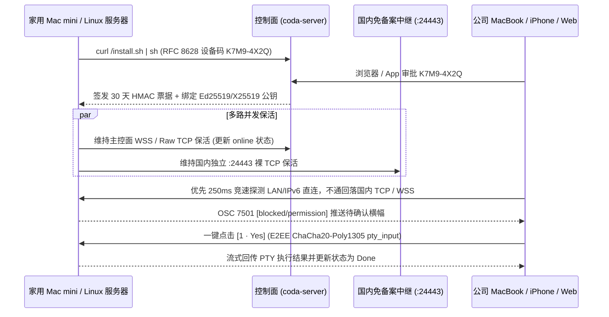

# Coda 全端产品原型与设计规范书（Product Prototype & Design Spec）

> **对齐版本**：`v0.5.0` → `v0.6.0`  
> **可交互高保真原型台**：直接在浏览器打开 [docs/prototype/index.html](prototype/index.html)（零外部构建依赖，支持 6 端切换、全局状态联动、中英双语、路由模拟与交互标注抽屉）  
> **覆盖形态**：Web 桌面端、Web 手机端 / Safari PWA、macOS GPUI 桌面端（`Coda.app`）、iPadOS 分栏工作台、iPhone 原生 SwiftUI、iPhone Duo 折叠屏（外屏 / 展开双栏 / 笔电半折三态）

---

## 一、产品定位与核心体验原则

Coda 是一款**零知识端到端加密（Zero-Knowledge E2EE）的跨设备 AI Coding Agent 工作台**，把家里的 Mac mini、公司 MacBook Pro、云端 Linux 服务器与随身手机/平板连接成一张统一的实时终端协作网络。

1. **Attention-First（注意力优先）**：所有终端按 `Needs you（待确认） → Error（异常） → Done（未读完工） → Working（运行中） → Idle（空闲）` 排序，一眼定位阻塞的 Claude Code / Codex / Gemini 会话。
2. **零延迟全双工操作**：按键与指令优先直走 `pty_input` 原始字节流（无轮询等待），审批横幅提供一键 `1 · Yes` / `2 · Always` / `Esc`。
3. **无感网络漫游**：局域网 Wi-Fi IPv4 / 公网 IPv6 直连优先，跨网自动回落国内免备案裸 TCP (`:24443`) 或海外 CDN WSS (`/v1/tunnel/ws`)，且 `coda-daemon` 并发保活主控与国内边缘节点。
4. **安全与控制权显式化**：macOS `Coda.app` 提供显式 **「允许远端控制本机（Allow Remote Control）」** 开关与 Keychain 凭据保护，随时在 `hybrid`（双向互控）与 `client`（纯控制端）间切换。

---

## 二、统一设计系统 Token（Design Tokens）

### 1. 色彩体系（三端暗黑基线对齐）

| 语义角色 | Web 控制台 (OLED) | macOS GPUI (Obsidian) | Apple SwiftUI (Herdr Dark) | 用途 |
| :--- | :---: | :---: | :---: | :--- |
| **Canvas 背景** | `#000000` | `#0A0B0E` | `#0B0C0F` | 终端主画布与根背景 |
| **Sidebar / Card** | `#111113` | `#0D0E11` / `#14161B` | `#13151A` | 侧边栏、卡片、弹窗容器 |
| **Elevated / Active** | `#18181B` / `#222226` | `#1B1E25` | `#1A1D24` / `#232731` | 悬浮工具栏、选中项、按钮 |
| **Border Hairline** | `#222226` | `#1E222B` | `#262A33` | 1px 分隔线与卡片描边 |
| **Primary Text** | `#FFFFFF` | `#E6EDF3` | `#F0F3F6` | 主标题与终端默认前景 |
| **Secondary / Dim** | `#A1A1AA` / `#52525B` | `#8B949E` / `#525866` | `#8B949E` / `#59626E` | 辅助信息、分支、路径 |
| **Needs You (Amber)** | `#F59E0B` | `#F59E0B` | `#F59E0B` | OSC 7501 阻塞审批与提醒 |
| **Working (Sky)** | `#38BDF8` | `#38BDF8` | `#38BDF8` | Agent 运行态、活跃焦点、主操作 |
| **Unread Done (Blue)** | `#3B82F6` | `#38BDF8` | `#3B82F6` | 未读完成状态标识 |
| **Online / Diff +** | `#22C55E` | `#22C55E` | `#3FB950` | 在线圆点、直连路由、Git 新增行 |
| **Error / Diff -** | `#EF4444` | `#F87171` | `#F85149` | 错误提示、`^C`、删除、Git 删除行 |

### 2. 字体规范
- **UI 正文**：`Inter` / `SF Pro Text` / `PingFang SC`（字号 `11px`–`15px`，数字启用 `tabular-nums`）
- **终端与代码**：`JetBrains Mono` / `SF Mono` / `Menlo`（禁用连字 `font-variant-ligatures: none`，默认 `12.5px`–`13px`，行高 `1.35`–`1.52`）

---

## 三、全端信息架构（Information Architecture）

```mermaid
flowchart TD
    Root["Coda 零知识跨设备工作网"] --> Web["Web 控制台 (Desktop & Mobile PWA)"]
    Root --> Mac["macOS GPUI 桌面端 (Coda.app)"]
    Root --> Apple["Apple Swift 6 (iPadOS / iPhone / iPhone Duo)"]

    Web --> W1["/ 官网与免登录下载中心"]
    Web --> W2["/activate RFC 8628 主机审批"]
    Web --> W3["/app 三栏终端工作台 (<900px 抽屉态)"]
    Web --> W4["Agent 启动器 / Whisper 语音 / 多标签设置中心"]

    Mac --> M1["左侧边栏 (本地工作区 + 远端主机 + 终端树)"]
    Mac --> M2["中央终端画布 (单窗 / ⌘D 双分屏 / 单元格拖选)"]
    Mac --> M3["右侧抽屉 (Changes Diff / Files 预览 / Mesh 被控开关)"]
    Mac --> M4["⌘K 命令面板 + 设置中心 (改名/移除/改密)"]

    Apple --> A1["iPhone 竖屏 (Inbox | Spaces 浮底栏 -> 全屏终端)"]
    Apple --> A2["iPadOS 分栏 (288pt 侧栏 + 实时终端 + Diff/Compose 弹窗)"]
    Apple --> A3["iPhone Duo 三态 (5.4\" 外屏 / 7.6\" 折痕双栏 / 笔电半折控制甲板)"]
```

---

## 四、核心用户旅程流程（Key User Journeys）

### 1. 受控机接入与多端协同主流程



### 2. 双向被控（家里 Mac mini ↔ 公司 MacBook Pro）
- 家用 Mac mini 安装 `Coda.app` 并保持 **「允许远端控制本机（Allow Remote Control）」= 开启（`hybrid`）**，或后台运行独立 `coda-daemon`；
- 公司 MacBook Pro 同样登录同一账号，按需关闭自身被控开关（`client`），即可在左侧主机列表无缝接管家里的 Mac mini 工作区与终端，且自动屏蔽本机设备防止自连。

### 3. Whisper 语音转写输入链路（Web & Apple）
- **Web**：点击输入栏 `🎙 语音` → `MediaRecorder` 采集音频 → 停止后以 `multipart/form-data` 调用 `POST <base_url>/audio/transcriptions`（未填 API Key 时自动回落浏览器 `SpeechRecognition`）→ 结果自动插入命令输入框。
- **Apple**：点击 Compose 弹窗 `🎙 Voice` → `CodaVoiceRecorder`（`AVAudioRecorder` 16kHz Mono AAC `.m4a`）录音 → 强制校验 `https://` 或 `localhost` 端点后上传转写 → 写入提示词编辑器。

---

## 五、六端功能与交互形态对照矩阵

| 能力维度 | Web 桌面端 | Web 手机 PWA | macOS GPUI (`Coda.app`) | iPadOS | iPhone | iPhone Duo 折叠屏 |
| :--- | :---: | :---: | :---: | :---: | :---: | :---: |
| **视口与布局形态** | 三栏工作台 (`≥900px`) | `100dvh` + 抽屉侧栏 (`<900px`) | 原生三栏 + `⌘D` 双分屏 | 288pt 可折叠分栏 (`⌘B`) | 浮底双 Tab → 全屏推送 | 5.4" 外屏 ↔ 7.6" 折痕双栏 ↔ 笔电半折 |
| **终端渲染引擎** | `WebVtTerminal`（**v0.6 行级脏区 Diff**） | `WebVtTerminal`（行级脏区 Diff） | GPUI 2D Cell Grid (Metal 120Hz) | `GhosttyReflowEngine` | `GhosttyReflowEngine` | `GhosttyReflowEngine`（随折态动态列重排） |
| **输入方式** | 终端直输原始按键 + Bracketed Paste | 1 步直发栏 + 双排触控键盘 | 原生直输 + 鼠标拖选复制 + IME | 外接键盘 + 悬浮快捷条 + Compose | 悬浮快捷条 + 双排触控键盘 + Compose | 笔电半折下半屏专属控制甲板 |
| **Whisper 语音输入** | `MediaRecorder` + Speech 回退 | `MediaRecorder` + Speech 回退 | 规划中（复用配置） | `AVAudioRecorder` + Whisper | `AVAudioRecorder` + Whisper | `AVAudioRecorder` + Whisper |
| **双向被控开关** | 纯控制端 | 纯控制端 | **显式 `Allow Remote Control` 开关** | 纯控制端 | 纯控制端 | 纯控制端 |
| **Git Diff / 文件** | Diff 面板 + 文件上传 | Diff 面板 + 文件上传 | Changes Diff + Files 树预览 | Diff 弹窗 + 文件上传 | Diff 弹窗 + 文件上传 | **展开态右侧内联 Studio Diff 屏** |
| **账号/设备生命周期** | 重命名/删除/会话/邀请码/改密/注销 | 同左 | 改名/删除/改密/Keychain 存储 | 审批码/邀请码/改名/删除/改密/注销 | 同左 | 同左 |

---

## 六、快捷键与手势交互规范

### 1. 桌面端与 iPad 外接键盘快捷键

| 快捷键 | 作用域 | 行为 |
| :--- | :--- | :--- |
| `⌘ K` / `⌘ P` | GPUI / iPad | 呼出命令面板 / 聚焦侧边栏搜索 |
| `⌘ B` | GPUI / iPad | 展开 / 折叠左侧边栏 |
| `⌘ D` | GPUI | 开启 / 关闭主副双终端分屏 |
| `⌘ N` / `⌘ T` | GPUI | 在当前工作区新建终端 |
| `⌘ W` | GPUI | 关闭当前聚焦终端 |
| `⌘ ,` | GPUI | 打开设置弹窗 |
| `⌘ C` / `⌘ V` | GPUI / Web | 有选区复制选区（无选区不覆盖剪贴板）/ Bracketed Paste 粘贴 |
| `⌘ +` / `⌘ -` / `⌘ 0` | GPUI | 放大 / 缩小 / 重置终端字号 |
| `⌃ C` / `⌃ L` | 全端 | 发送 `SIGINT (0x03)` / 清屏保留历史 scrollback |

### 2. 移动端与折叠屏手势

| 手势 / 姿态 | 适用端 | 行为 |
| :--- | :--- | :--- |
| **顶部标题栏左右轻扫** | iPhone / iPad | 在同工作区兄弟终端窗格间快速切换 |
| **Inbox 列表项右滑 / 左滑** | iPhone | 右滑标记已读或置顶；左滑快速发送 `Esc` 中断 |
| **双指捏合（防抖）** | iPhone / iPad | 动态缩放终端字号，松手后重算行列并通知远端 PTY `TIOCSWINSZ` |
| **终端向上拖动** | iPhone / iPad / Web | 自动锁定历史滚动视口（不强制拉回底部），右下角显示回底高亮箭头 |
| **折叠 / 展开 / 半折 90°** | iPhone Duo | 自动在 58 列外屏 ↔ 避让 24pt 垂直折痕双栏 ↔ 水平折痕笔电控制甲板间无缝重排 |
