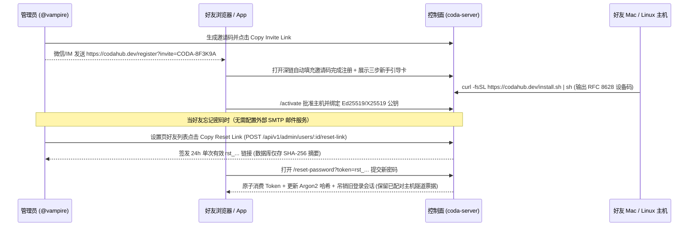
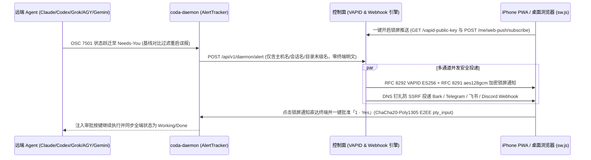

# Coda 全端产品原型与设计规范书（Product Prototype & Design Spec）

> **对齐版本**：`v1.1.1`（全端能力对齐与好友圈零门槛交付基线）  
> **可交互高保真原型台**：直接在浏览器打开 [docs/prototype/index.html](prototype/index.html)（零外部构建依赖，支持 6 端切换、全局状态联动、中英双语、智能链路模拟、`Needs-You` 事件模拟与交互设计标注抽屉）  
> **支持智能体矩阵**：`Claude Code`、`Codex`、`Grok CLI`、`Antigravity (AGY)`、`Gemini CLI`（及 `herdr-core` / 原生 Unix PTY Shell）  
> **覆盖形态**：Web 桌面端、Web 手机端 / Safari PWA、macOS GPUI 桌面端（`Coda.app`）、iPadOS 分栏工作台、iPhone 原生 SwiftUI、iPhone Duo 折叠屏（5.4" 外屏 / 7.6" 展开双栏 / 笔电半折三态）

---

## 一、产品定位与核心体验原则

Coda 是一款**支持好友圈多租户隔离、零知识端到端加密（Zero-Knowledge E2EE）的跨设备 AI Coding Agent 工作台**，把家里的 Mac mini、公司 MacBook Pro、云端 Linux 服务器与随身手机/平板连接成一张统一的实时终端协作网络。

1. **五大主力 AI Agent 原生编排**：开箱即用支持 **`Claude Code`、`Codex`、`Grok CLI`、`Antigravity (AGY)`、`Gemini CLI`** 与原生 Shell，并内置远端目录选择器与沙箱化 `git clone` 工作区引导（`BootstrapWorkspace`）。
2. **Attention-First（注意力优先与锁屏闭环）**：侧边栏置顶 `NEEDS ATTENTION` 收件箱并支持 `⌘J`（`Ctrl+Shift+J`）一键环形速跳；离线时由守护进程零明文触发 **W3C VAPID 原生锁屏 Web Push（`sw.js`）** 与 **Bark / Telegram / 飞书 / Discord Webhook**。
3. **统一 E2EE 工作区检视器（Inspector）**：全端对齐 **`Files（文件树与代码预览） | Changes（含 ?? 未跟踪新建文件绿色 + 补丁的 Git Diff） | Port Preview（沙箱预览与 GPUI 127.0.0.1 全方法本地回环隧道）`**。
4. **多模态输入与跨端快捷指令（Prompt Composer）**：自适应 `?2004h` 多行指令编辑器内置**跨设备云同步快捷指令胶囊（Saved Snippets）**、**`⌘V` 剪贴板截图 / iOS `PhotosPicker` 相册一键加密直传**，以及**免配置系统原生语音听写 + E2EE 守护进程代理 Whisper（`TranscribeAudio`）**。
5. **好友圈零门槛交付与零中断自更新**：支持一键复制**好友邀请注册深链（`/register?invite=CODA-XXXXXX`）**、**管理员免邮件一键重置好友密码链接（`/reset-password?token=rst_...`）**、三步空状态新手引导卡片、`coda-daemon` `SIGUSR1` 零中断热升级与 `Coda.app` 顶栏一键应用内自更新（`✨ Update v1.1.1`）。

---

## 二、统一设计系统 Token（Design Tokens）

### 1. 色彩体系（三端暗黑基线对齐）

| 语义角色 | Web 控制台 (OLED) | macOS GPUI (Obsidian) | Apple SwiftUI (Herdr Dark) | 用途 |
| :--- | :---: | :---: | :---: | :--- |
| **Canvas 背景** | `#000000` | `#0A0B0E` | `#0B0C0F` | 终端主画布与根背景 |
| **Sidebar / Card** | `#111113` | `#0D0E11` / `#14161B` | `#13151A` | 侧边栏、新手引导卡、检视器与弹窗容器 |
| **Elevated / Active** | `#18181B` / `#222226` | `#1B1E25` | `#1A1D24` / `#232731` | 悬浮工具栏、Snippet 胶囊、选中项 |
| **Border Hairline** | `#222226` | `#1E222B` | `#262A33` | 1px 分隔线与卡片描边 |
| **Primary Text** | `#FFFFFF` | `#E6EDF3` | `#F0F3F6` | 主标题与终端默认前景 |
| **Secondary / Dim** | `#A1A1AA` / `#52525B` | `#8B949E` / `#525866` | `#8B949E` / `#59626E` | 辅助信息、分支、CPU/RAM 遥测 |
| **Needs You (Amber)** | `#F59E0B` | `#F59E0B` | `#F59E0B` | OSC 7501 阻塞审批、置顶提醒与自更新胶囊 |
| **Working / Tunnel (Sky)** | `#38BDF8` | `#38BDF8` | `#38BDF8` | Agent 运行态、`127.0.0.1` 代理隧道、焦点 |
| **Unread Done (Blue)** | `#3B82F6` | `#38BDF8` | `#3B82F6` | 未读完工状态标识 |
| **Online / Diff + / `??`** | `#22C55E` | `#22C55E` | `#3FB950` | 在线圆点、P2P 直连、Git 新增与 `??` 新文件补丁 |
| **Error / Diff -** | `#EF4444` | `#F87171` | `#F85149` | 错误提示、`^C`、吊销操作、Git 删除行 |

### 2. 字体规范
- **UI 正文**：`Inter` / `SF Pro Text` / `PingFang SC`（字号 `11px`–`15px`，遥测与端口号启用 `tabular-nums`）
- **终端与代码**：`JetBrains Mono` / `SF Mono` / `Menlo`（禁用连字 `font-variant-ligatures: none`，默认 `12.5px`–`13px`，行高 `1.35`–`1.52`）

---

## 三、全端信息架构（Information Architecture · v1.1.1）

```mermaid
flowchart TD
    Root["Coda v1.1.1 零知识跨设备 AI 开发网"] --> Web["Web 控制台 (Desktop & Safari PWA)"]
    Root --> Mac["macOS GPUI 桌面端 (Coda.app)"]
    Root --> Apple["Apple Swift 6 (iPadOS / iPhone / iPhone Duo)"]

    Web --> W1["/ 官网下载页 + /register?invite= 邀请深链 + /reset-password 重置页"]
    Web --> W2["/activate RFC 8628 设备码审批 + 空状态三步新手引导卡"]
    Web --> W3["/console 双分屏工作台 (置顶 Needs-You ⌘J + ⌘F 搜索 + .md 导出)"]
    Web --> W4["三合一检视器 (Files | Changes 含 ?? 新文件 | 沙箱 Port Preview)"]
    Web --> W5["多行 Composer (云同步 Snippets + ⌘V 截图 + 原生语音/E2EE Whisper)"]
    Web --> W6["sw.js W3C VAPID 锁屏推送 + 五类 Webhook + 好友管理/重置链接"]

    Mac --> M1["左侧栏 (NEEDS ATTENTION ⌘J + 主机 CPU/RAM/OTA + 5 大 Agent 启动器)"]
    Mac --> M2["中央 Metal 120Hz 画布 (⌘D 分屏 + ⌘F 搜索 + ✨ Update v1.1.1 自更新)"]
    Mac --> M3["右侧检视器 (Changes | Files | 127.0.0.1 全方法代理隧道 | Mesh 被控开关)"]
    Mac --> M4["⌘K 命令面板 (含 Snippets 速发) + 截图粘贴 + 好友重置管理"]

    Apple --> A1["iPhone 竖屏 (Inbox 置顶审批 | Spaces 主机健康 + 三步新手引导卡)"]
    Apple --> A2["iPadOS 分栏 (288pt 侧栏 + GhosttyReflow 终端 + 三合一检视器弹窗)"]
    Apple --> A3["iPhone Duo 三态 (5.4 寸外屏 / 7.6 寸避折痕双栏 / 笔电半折控制甲板)"]
    Apple --> A4["移动端多模态 Composer (云同步 Snippets + PhotosPicker/剪贴板图 + SFSpeechRecognizer)"]
```

---

## 四、核心用户旅程流程（Key User Journeys · v1.1.1）

### 1. 好友邀请深链、管理员一键重置密码与受控机入网

### 2. 零知识离线告警闭环（W3C VAPID 锁屏推送 + Webhook）

### 3. 统一 E2EE 工作区检视器（`Files | Changes | Port Preview`）
- **`Files`（文件透视）**：端到端加密拉取远端工作区目录树与代码文件预览（超长文件自动标注 `truncated`），支持与 Diff 视图一键互跳。
- **`Changes`（增强型 Git Diff）**：实时展示当前分支、`+added / -deleted` 统计与 `repo_root` 定位；除常规 `M`/`A`/`D` 变更外，自动为 **`??` 未跟踪新建文件生成绿色 `+` 合成统一补丁**，避免遗漏 Agent 新创建的源码文件。
- **`Port Preview`（全方法本地端口预览与回环隧道）**：
  - **macOS GPUI (`Coda.app`)**：自动为远端活跃端口分配本地 `http://127.0.0.1:<local_port>` 全方法回环代理（完整支持 `GET` / `POST` / `PUT` / `PATCH` / `DELETE`、请求体及 `Location` / `Set-Cookie` 响应头透传），直接用本地浏览器无感调试远端 Web 服务。
  - **Web 控制台与 Apple 端**：通过 E2EE `HttpLocalPreview` 在隔离沙箱视图中实时预览远端 `localhost` 页面与接口响应。

### 4. 多行 `Prompt Composer`、跨端快捷指令、截图直传与零配置语音
- **跨设备云同步快捷指令（Saved Snippets）**：通过 `GET / PUT /api/v1/me/snippets` 同步常用提示词胶囊（内置 `Run Tests & Fix`、`Review Git Diff`、`Continue`、`Clean Commit` 四大模板并支持自定义增删），在底部输入栏、多行 Composer 与 `⌘K` 命令面板一键插入或发送。
- **`⌘V` 剪贴板截图与相册一键直传**：在 Web 或 `Coda.app` 按下 `⌘V` / `Ctrl+V`（富文本粘贴自动识别纯文本不误拦，仅在剪贴板含截图位图时触发），或在 iOS/iPadOS 通过 `PhotosPicker` 选图，经 E2EE `upload_terminal_file` 上传至远端工作区临时目录并自动将文件路径填入光标处供多模态 Agent 读取。
- **三级语音听写链路**：支持 ① **零配置系统原生语音识别**（Web `SpeechRecognition` / iOS `SFSpeechRecognizer` / macOS 原生听写）免 Key 即开即用；② **E2EE 守护进程代理 Whisper（`TranscribeAudio`）** 复用远端主机凭据转写；③ 客户端直连 HTTPS Whisper 兼容接口。

### 5. 守护进程零中断 OTA 与 `Coda.app` 应用内一键自更新
- **远端 `coda-daemon` 零中断热升级**：支持本地 `coda-daemon upgrade` 或在任意客户端主机卡片一键触发 E2EE `UpgradeDaemon` —— 自动下载对应架构产物、严格校验 `SHA256SUMS`、原子替换二进制并通过 `SIGUSR1` 热重执，全程不断开正在运行的 `herdr-core` Agent 会话。
- **`Coda.app` 应用内自更新（Self-Updater）**：自动比对 `/api/v1/site-info` 与 GitHub Releases 最新语义化版本；发现新版时顶栏浮现 **`✨ Update v1.1.1`** 胶囊，点击后后台下载并校验 `SHA256SUMS`、清理 `com.apple.quarantine` 隔离属性、冒烟验证 `--version` 后原子替换并自动重启应用。

---

## 五、六端功能与交互形态对照矩阵（`v1.1.1`）

| 能力维度 | Web 桌面端 | Web 手机 PWA | macOS GPUI (`Coda.app`) | iPadOS | iPhone | iPhone Duo 折叠屏 |
| :--- | :---: | :---: | :---: | :---: | :---: | :---: |
| **视口与布局形态** | 三栏 + 双分屏 (`≥900px`) | `100dvh` + 浮层抽屉 (`<900px`) | 原生三栏 + `⌘D` 双分屏 | 288pt 可折叠分栏 (`⌘B`) | 浮底双 Tab → 全屏终端 | 5.4" 外屏 ↔ 7.6" 折痕双栏 ↔ 笔电半折 |
| **5 大支持 Agent** | Claude / Codex / Grok / AGY / Gemini | 同左 | 同左（含远端目录选择 & `git clone`） | 同左（含 `git clone` 引导） | 同左（含 `git clone` 引导） | 同左（含 `git clone` 引导） |
| **终端引擎与检索** | `WebVtTerminal` 脏行 Diff + `⌘F` + `.md` | `WebVtTerminal` + 检索 + `.md` | GPUI Metal 120Hz + `⌘F` + `.md` | `GhosttyReflow` + 检索 + `.md` | `GhosttyReflow` + 检索 | `GhosttyReflow` 动态列重排 + 检索 |
| **Needs-You 收件箱** | 侧栏置顶 + `⌘J` 速跳 + 横幅 | 抽屉置顶 + 顶部审批横幅 | 侧栏置顶 + `⌘J` + Dock 角标 | 侧栏置顶 + 悬浮审批胶囊 | Inbox 强优先排序 + 横幅 | 左叶置顶 / 半折甲板直批 |
| **Composer 与 Snippets** | `?2004h` 多行 + 云同步胶囊 | 一步直发 + 多行弹窗 + 胶囊 | 内联/抽屉胶囊 + `⌘K` 速发 | 多行弹窗 + 胶囊增删同步 | 多行弹窗 + 胶囊增删同步 | 笔电甲板直发 + 胶囊同步 |
| **截图粘贴与文件直传** | `⌘V` / `Ctrl+V` 截图 + 拖拽上传 | 相册/文件选择器 E2EE 上传 | `⌘V` 剪贴板截图直传 | `PhotosPicker` + 剪贴板图直传 | `PhotosPicker` + 剪贴板图直传 | `PhotosPicker` + 剪贴板图直传 |
| **零配置语音 & Whisper** | `SpeechRecognition` + E2EE Whisper | `SpeechRecognition` + E2EE Whisper | 原生听写回落 + E2EE Whisper | `SFSpeechRecognizer` + E2EE Whisper | `SFSpeechRecognizer` + E2EE Whisper | `SFSpeechRecognizer` + E2EE Whisper |
| **三合一工作区检视器** | `Files \| Changes(??) \| 沙箱 Port` | 弹窗式三合一检视器 | `Changes(??) \| Files \| 127.0.0.1 隧道` | 弹窗式三合一检视器 | 弹窗式三合一检视器 | **展开态右侧内联三合一检视屏** |
| **锁屏推送 & Webhook** | **一键 VAPID Web Push (`sw.js`)** + Webhook | **iOS 主屏幕 PWA 锁屏推送** + Webhook | 5 类 Webhook 配置 + 桌面提醒 | 5 类 Webhook 配置与测试 | 5 类 Webhook 配置与测试 | 5 类 Webhook 配置与测试 |
| **好友邀请 / 重置 / OTA** | 邀请深链 + 重置路由 + 主机 OTA | 同左 | **顶栏 `✨ Update` 自更新** + 好友重置 + 主机 OTA | 邀请深链复制 + 好友重置 + 主机 OTA | 同左 | 同左 |

---

## 六、快捷键与手势交互规范

### 1. 桌面端（GPUI / Web）与 iPad 外接键盘快捷键

| 快捷键 | 作用域 | 行为 |
| :--- | :--- | :--- |
| `⌘ K` / `⌘ P` | GPUI / Web / iPad | 呼出命令面板（快速跳转工作区、执行云同步 Saved Snippets、新建 Agent 或导出会话） |
| `⌘ J` / `Ctrl+Shift+J` | GPUI / Web | 一键环形跳转到下一个处于 `Needs-You` 待确认阻塞状态的终端会话 |
| `⌘ F` | GPUI / Web | 展开 / 收起终端内联历史回滚搜索栏（实时高亮匹配行并上下跳转） |
| `⌘ D` | GPUI / Web | 开启 / 关闭主副双终端并排分屏视图（Split View） |
| `⌘ B` | GPUI / iPad | 展开 / 折叠左侧工作区与会话边栏 |
| `⌘ V` / `Ctrl+V` | GPUI / Web / iPad | 智能粘贴：纯文本/富文本走 `?2004h` Bracketed Paste；剪贴板截图自动经 E2EE 上传并插入远端路径 |
| `⌘ C` | GPUI / Web | 有选区时复制终端选区文本（无选区时不覆盖系统剪贴板） |
| `⬇ .md`（面板/顶栏） | 全端 | 一键剥离 ANSI 控制序列并将当前终端完整上下文导出为 `.md` Markdown 记录 |
| `⌘ N` / `⌘ T` | GPUI | 在当前工作区或远端主机新建 Agent / Shell 终端（支持目录浏览与 `git clone`） |
| `⌘ W` | GPUI | 关闭当前聚焦终端窗格 |
| `⌘ ,` | GPUI | 打开全端设置中心（主机健康与 OTA、锁屏推送/Webhook、好友管理与重置链接、语音与 Snippets） |
| `⌘ +` / `⌘ -` / `⌘ 0` | GPUI | 放大 / 缩小 / 重置终端等宽字号并同步 `TIOCSWINSZ` |
| `⌃ C` / `⌃ L` | 全端 | 发送 `SIGINT (0x03)` 中断信号 / 清屏并保留历史 scrollback |

### 2. 移动端与折叠屏手势

| 手势 / 姿态 | 适用端 | 行为 |
| :--- | :--- | :--- |
| **顶部标题栏左右轻扫** | iPhone / iPad | 在同工作区兄弟终端窗格间快速切换 |
| **Inbox 列表项右滑 / 左滑** | iPhone | 右滑标记已读或置顶；左滑快速发送 `Esc` 中断阻塞会话 |
| **双指捏合（防抖）** | iPhone / iPad | 动态缩放终端字号，松手后重算行列并通知远端 PTY `TIOCSWINSZ` |
| **终端向上拖动** | iPhone / iPad / Web | 自动锁定历史滚动视口（刷屏不强制拉回底部），右下角浮现回底高亮按钮 |
| **折叠 / 展开 / 半折 90°** | iPhone Duo | 自动在 58 列外屏 ↔ 避让 24pt 垂直折痕双栏（内联三合一检视屏） ↔ 水平折痕笔电控制甲板间无缝重排 |
